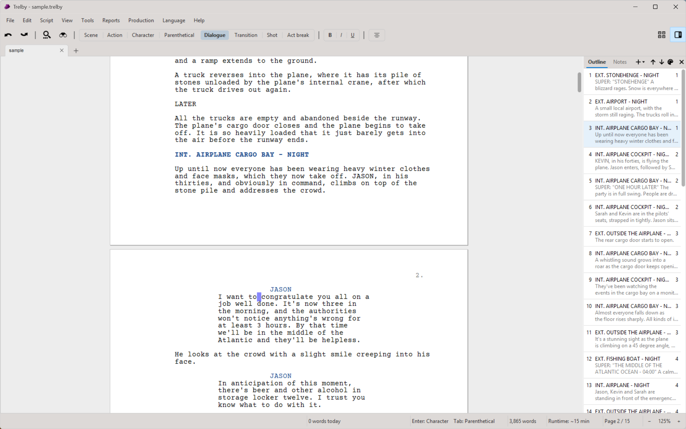

<h1 align="center">Trelby</h1>

<p align="center">
  <strong>Free, open-source screenwriting software that gets out of your way.</strong><br>
  Industry-standard formatting, a scene outliner, revisions and production tools, on Windows, macOS and Linux.
</p>

<p align="center">
  <a href="https://github.com/trelby/trelby/releases">Download</a> ·
  <a href="https://www.trelby.org/">Website</a> ·
  <a href="#installation">Install</a> ·
  <a href="#features">Features</a>
</p>



## Write the story. Trelby handles the format.

Trelby is a screenwriting app for people who want to spend their time on the script, not on margins and page breaks. Press Enter and Tab to move between scene headings, action, characters and dialogue; Trelby keeps every element where it belongs and paginates the way a reader expects, (MORE) and (CONT'D) included.

It's free and always will be: no subscription, no account, no cloud lock-in. Your scripts are plain files on your own computer, and they open in Final Draft, Fountain editors and Word when you need to share them.

### Who it's for

- **Screenwriters** drafting features, shorts and pilots who want proper format without paying for it.
- **Students and teachers** who need a tool every student can install on any machine.
- **Indie and student productions** that need revision colors, locked pages and scene numbers, and breakdown reports.
- **Writers moving between apps**, with import from Final Draft, Fountain, Fade In, Celtx, Adobe Story and PDF.
- **Sitcom, stage play, audio drama and comic writers**, with templates laid out for each.

## Features

### Writing
- **Automatic screenplay formatting** with keyboard-driven element switching, and auto-completion for character names, locations and transitions.
- **Page view or draft view**, side by side pages, zoom and full screen.
- **Focus mode and typewriter scrolling**: fade everything but the scene you're in, and keep your line in the middle of the screen.
- **Spell checking as you type**, a built-in thesaurus, and a database of over 200,000 character names.

### Structure
- **Scene outliner**: see every scene with its synopsis, drag scenes to reorder them, color-code them, and fold acts.
- **Beat board**: index cards on a corkboard, with pictures, colors and acts, for working out the story before (or alongside) the pages.
- **Beat sheet templates** to start an outline from, notes on any paragraph, character profiles and world-building notes.

### Rewriting and production
- **Revision mode** with colored revision pages (Blue, Pink, Yellow...), revision marks in the margin, locked pages and scene numbers, omitted scenes, and printing only the revised pages.
- **Compare two versions** of a script to see what changed.
- **Reports**: scenes, locations, characters, and a dialogue chart of who speaks when.
- **Table read**: hear the script read aloud, each character in their own voice.

### Writing habits
- **Daily and weekly goals**, a writing history with streaks, and timed writing sprints.

### Import and export
- **Export** to PDF (with your choice of font and optional watermarks), Final Draft (FDX), Fountain, Word (DOCX), RTF, HTML and plain text.
- **Import** from Final Draft, Fountain, Fade In, Celtx, Adobe Story, formatted text, and text-based PDFs.

### AI assistants (optional)
- A built-in **MCP server** lets assistants like Claude read and edit your open script, with every change undoable. It's off unless you turn it on.

## Installation

### Download

Windows, macOS and Linux builds are on the [releases page](https://github.com/trelby/trelby/releases). Unzip and run `Trelby`. The builds aren't code-signed yet, so Windows SmartScreen and macOS Gatekeeper will ask you to confirm the first time.

### Package managers

| Platform | Command |
| --- | --- |
| Fedora | `sudo dnf install trelby` |
| Windows ([Chocolatey](https://chocolatey.org/install)) | `choco install trelby` |
| Flatpak | `flatpak install trelby` |
| PyPI | `pip install trelby` |

### From source

Trelby needs Python 3.10 or later.

```bash
git clone https://github.com/trelby/trelby.git
cd trelby
python3 -m venv .venv
.venv/bin/pip install -r requirements.txt   # .venv/Scripts/pip on Windows
.venv/bin/python trelby.py
```

*Depending on your Python version you might run into [wxWidgets/Phoenix#2296](https://github.com/wxWidgets/Phoenix/issues/2296). Running `pip install attrdict3` before installing the requirements usually fixes it; otherwise, try a newer Python.*

## Contributing

Trelby is free software under the [GPL](LICENSE), and contributions from developers, translators and screenwriters are welcome. See [README.dev](README.dev) to get started and [TRANSLATION_NOTES.txt](TRANSLATION_NOTES.txt) to help translate.

Trelby was created by Osku Salerma. This version brings together the [limburgher/trelby](https://github.com/limburgher/trelby) fork's move to Python 3 with new features and builds for every platform.
